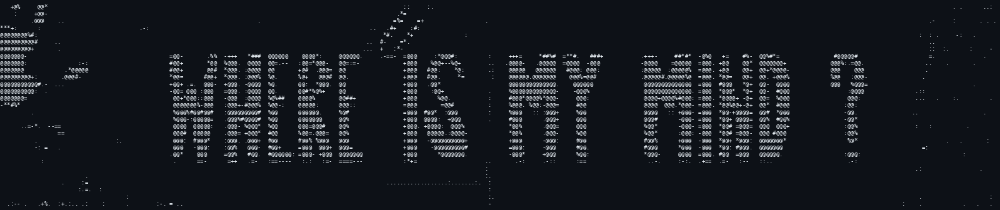

<!-- ═════════════ HEADER ═════════════ -->

  

<!-- ═════════════ INTRO ═════════════ -->
<h2 align="center">Hi 👋, I'm Anuj</h2>

### Full Stack Developer & UI/UX Designer

 

<!-- ═════════════ ABOUT ME ═════════════ -->
<h2 align="center">About Me</h2>

<table width="100%">
<tr>
<td width="66%" valign="top">

I'm **Anuj**, from India 🇮🇳 — a **Full Stack Developer & UI/UX Designer** who loves crafting end-to-end web experiences, architecting reliable systems, and turning creative ideas into pixel-perfect code.

- 🚀 **Building now:** Scalable full-stack web applications & modern digital products
- 💻 **What I love:** Coding clean architectures & designing intuitive, aesthetic user interfaces
- 🎨 **Creative side:** UI/UX design, visual prototyping, and frontend craftsmanship
- 🍿 **In my free time:** Watching movies & exploring cinema, listening to music, and unwinding
- 🎯 **Goal:** Engineer reliable software, build impactful products, and continuously level up
- 🤝 **Open to:** Full-stack roles, freelance opportunities, and collaborative projects
- 💬 **Ask me about:** React, Next.js, TypeScript, Python, FastAPI, Node.js & UI/UX Design

</td>
<td width="34%" align="center" valign="middle">

</td>
</tr>
</table>

 

<!-- ═════════════ LANGUAGES AND ACTIVITY ═════════════ -->
<h2 align="center">Languages and activity</h2>

<h4>🎨 Frontend & Design</h4>

  

<h4>⚙️ Backend & Database</h4>

  

<h4>🛠️ Tools & DevOps</h4>

  

 

<!-- GitHub Stats Grid (Styled in Cyber Cyan / Dark Mode) -->

  
  

  

  

 

<!-- ═════════════ CONTACTS ═════════════ -->
<h2 align="center">Contacts</h2>

  &nbsp;
  &nbsp;
  &nbsp;
  &nbsp;
  

 

<!-- ═════════════ FOOTER ═════════════ -->

  

